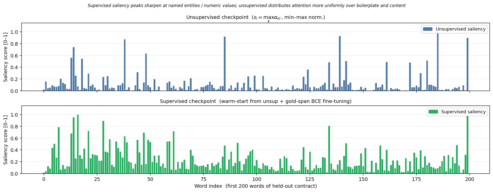

# MemSlot

MemSlot is a course project on whether document saliency can guide text selection and rendering before OCR. The MemSlot model learns attention slots over frozen RoBERTa features with a reconstruction objective, and its word weights decide which words are kept and set their font size and color. DeepSeek-OCR decodes the rendered pages into text, and a separate QA reader answers questions from that text.



Word saliency over the first 200 words of one held-out contract, from the unsupervised and the supervised warm-start MemSlot checkpoints. This is the saved output of cell 6 in `notebooks/MemSlot_Report.ipynb` ([source record](assets/provenance.json)).

## What is here

- `deepseek_pipeline/`: MemSlot saliency, the OCR wrapper, text pruning and summarization baselines, the QA reader, and local span-QA diagnostics.
- `render/`: text rendering and saliency-stitching code.
- `render/data/`: CUAD v1 data files (see [Data](#data)).
- `notebooks/`: experiment notebooks with their saved outputs, including the multipage OCR design.
- `run.py`: an earlier question-conditioned pipeline. It runs a CUAD-fine-tuned RoBERTa QA model (`akdeniz27/roberta-base-cuad`) on the first contract in `CUADv1.json` once for each of the 41 clause-type questions. For each word it keeps the highest answer-span score and the highest question-relevance score across questions, combines them with lexical and document-frequency priors, and renders the words in three size tiers. Its saved output is in `cuad_distorted_rendering/`.
- `tests/`: offline unit tests.
- [Pipeline notes](docs/METHODOLOGY.md) and the [multipage experiment plan](EXPERIMENT_DESIGN.md).

## Offline checks

With Python 3.10 or later:

```bash
python -m pip install -e .
python -m unittest discover -s tests -v
```

The core checks use NumPy fixtures and mocked OCR responses. They cover unanswerable questions, tied confidence scores, abstentions, word budgets, reading order, short-sequence saliency smoothing, and OCR return handling. Model and rendering tests are skipped when their optional dependencies are missing.

To also run the CPU attention, gradient, saliency, and image-layout tests:

```bash
python -m pip install -e '.[render]' torch
python -m unittest discover -s tests -v
```

These use random tensors and generated text images. They need no pretrained weights or API calls.

`cuad_evaluate` is a local diagnostic evaluator with EM, token F1, trapezoidal precision-recall area, and precision at recall of at least 0.8. For numbers comparable to published CUAD results, use the official CUAD evaluation code.

## Model experiments

Running the models needs model weights, data, a GPU for DeepSeek-OCR, and the notebook environment in `requirements.txt`. `DeepSeekOCRCompressor` accepts a model `revision`, so you can record the checkpoint revision.

`run.py` reads `render/data/CUADv1.json` by a relative path, so run it from the repository root. It downloads `akdeniz27/roberta-base-cuad` from Hugging Face and overwrites `cuad_distorted_rendering/`:

```bash
python -m pip install -e '.[render,model]'
python run.py
```

Before running a notebook, check its paths, dependency versions, split construction, prompts, and API settings.

- The package's summarizer and QA reader read `DEEPSEEK_API_KEY` or `DASHSCOPE_API_KEY`. Some notebooks also read `OPENAI_API_KEY` or `OPENROUTER_API_KEY`. The providers bill for these API calls.
- Run `notebooks/MemSlot_Report.ipynb` locally from this checkout. Its AUPR metrics use the `evaluate_answer` helper from the original COMP 586 project code; put it on the Python path before running the metrics cell.
- The notes in `notebooks/DeepSeek_OCR_CUAD_5X10X_Colab.ipynb` are in Chinese.

## Data

`render/data/` holds the CUAD v1 release: `CUADv1.json` (510 contracts), `train_separate_questions.json` (408) and `test.json` (102). The code reads only `CUADv1.json`; three of the notebooks download it from the CUAD GitHub repository if it is missing. [The Atticus Project](https://www.atticusprojectai.org/cuad) releases CUAD under CC BY 4.0, and Hendrycks et al. describe it in "CUAD: An Expert-Annotated NLP Dataset for Legal Contract Review" ([arXiv:2103.06268](https://arxiv.org/abs/2103.06268)). The MIT license in this repository covers the code, not the dataset.
